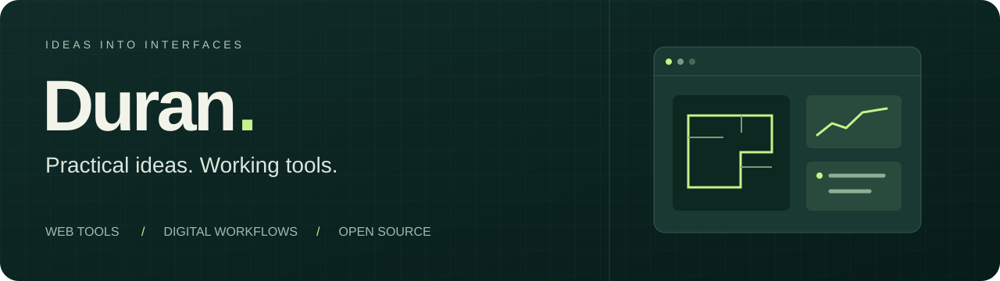

Practical tools for exploring systems, planning spaces and improving digital workflows. **Open a demo and try the work.**

<table><tr><td width="50%" valign="top">

### 01 · FlowLab

See where orders wait. Adjust capacity, automation and processing times, compare the same workload, and export a scenario report.

**[Try the demo ↗](https://mduransu-maker.github.io/flowlab/)** · [Code & model](https://github.com/mduransu-maker/flowlab)

</td><td width="50%" valign="top">

### 02 · SpaceSketch

Explore layouts in the browser, arrange components and export a PDF. A concept planner built with React, TypeScript and SVG.

**[Try the demo ↗](https://mduransu-maker.github.io/spacesketch/)** · [Code](https://github.com/mduransu-maker/spacesketch)

</td></tr></table>

### 03 · SmartMaintainer · contribution

My contribution adds an interactive demo workspace, analytics improvements and tests to an existing maintenance-management application. **[Contribution merged in PR #1 ↗](https://github.com/alem187/SmartMaintainer/pull/1)**

[Static demo build proposed in PR #2](https://github.com/alem187/SmartMaintainer/pull/2) · Public deployment awaits the project owner's Pages setup.

---

### Personal project · Fundament

A calm personal dashboard: six life areas, one quarterly focus, up to three daily actions. The real hosted instance stays private; the repository uses neutral example data.

[Explore the project ↗](https://github.com/mduransu-maker/fundament)
